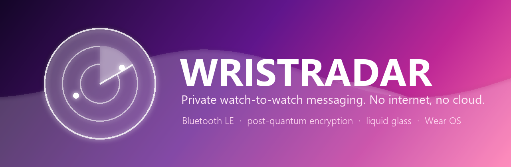
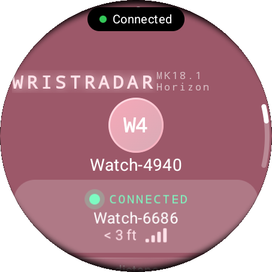
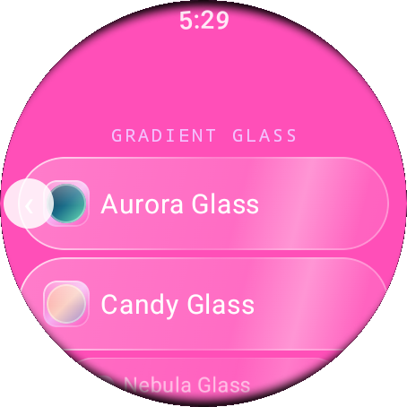
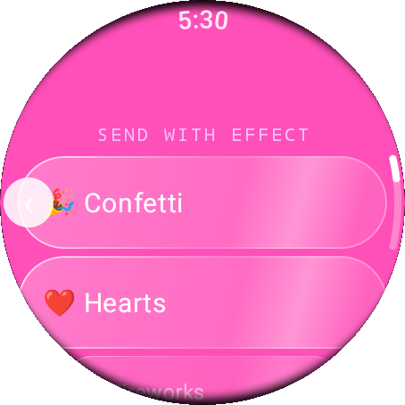
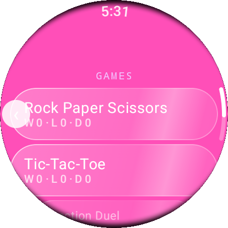
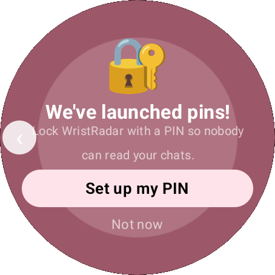
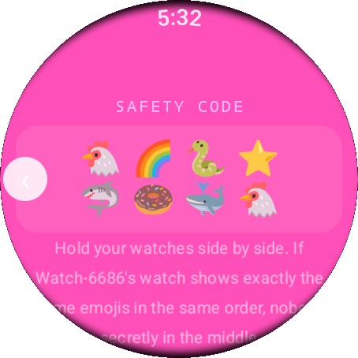
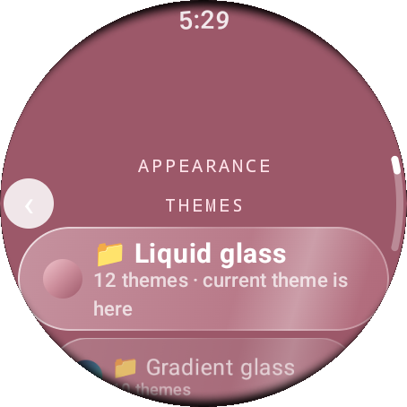
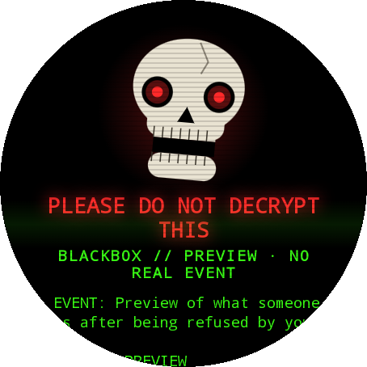

<p align="center">
  
</p>

<p align="center">
  <a href="https://github.com/doktordestrukt/WristRadar/releases/latest"></a>
  <a href="https://github.com/doktordestrukt/WristRadar/releases"></a>
  
  
</p>

<p align="center">
  
  
  
  
  
  
</p>

<p align="center">
  <a href="https://github.com/doktordestrukt/WristRadar/releases/latest"></a>
  <a href="WristRadar/README.md"></a>
  <a href="WristRadar/SECURITY.md"></a>
</p>

> **This was just made for fun, so I could text my friend on his watch, lol.** 😄

A private, **fully offline** messenger for smartwatches, by **doktordestrukt (aka ellie)**.

Two Wear OS watches talk **directly over Bluetooth Low Energy**: messages never touch the internet,
a phone, a SIM, an account, a server or the cloud. Built for, and tested on, the Samsung Galaxy
Watch FE (no LTE needed). A Windows PC companion speaks the same protocol.

> WristRadar is an independent personal project. It is not affiliated with or endorsed by Samsung
> or Google. It has **not** been independently security-audited.

---

## 📸 Screenshots

<table align="center">
  <tr>
    <td align="center"><br><sub><b>Home</b> · Dynamic Island</sub></td>
    <td align="center"><br><sub><b>Gradient glass</b> themes</sub></td>
    <td align="center"><br><sub><b>Message effects</b></sub></td>
    <td align="center"><br><sub><b>Games</b></sub></td>
  </tr>
  <tr>
    <td align="center"><br><sub><b>"We've launched pins!"</b></sub></td>
    <td align="center"><br><sub><b>Emoji safety code</b></sub></td>
    <td align="center"><br><sub><b>Theme folders</b></sub></td>
    <td align="center"><br><sub><b>BLACKBOX</b> intruder screen</sub></td>
  </tr>
</table>

<p align="center"><sub>Real screenshots from WristRadar running on Wear OS 6 emulators (test identities, no real chats).</sub></p>

---

## ✨ Features

<table>
  <tr>
    <td width="50%" valign="top">

**💬 Chat**
- Text, pictures (from the watch itself, never the cloud) and voice messages with sound waves
- Blue seen ticks, *Delivered / Read*, replies, reactions, edit, delete for both, pins, search
- Discord-style **bold**, *italic*, `code`, ||spoilers|| and big emojis
- 14 full-screen **message effects** - confetti, fireworks, lasers, rainbow, thunder…
- Keyboard opens on the first tap, right inside the app

**📞 Calls**
- Encrypted voice calls over Bluetooth, louder-call boost, mute shown to your friend

**🎮 Fun**
- Connect 4, Memory Match, Dice Duel, Rock Paper Scissors, Tic-Tac-Toe, Reaction Duel
- Draw & send, emoji blasts, tap code, streaks, mood, shared to-do list, hide & seek

</td>
    <td width="50%" valign="top">

**🎨 Looks**
- 50+ themes in folders: Liquid glass, Gradient glass, Soft glass, KK, Gradients, Dark
- The app icon changes to match your theme (round, launcher-safe)
- Tilt shimmer, tap ripples, night glass, Dynamic Island, haptic taps

**📡 Range**
- Max Range: Bluetooth LE Coded PHY (S2 → S8, up to ~4× normal reach) on both watches
- Watch-tuned distance + signal bars, one-tap calibration, walk-to-friend

**🔐 Security**
- App lock PIN, sealed in the watch's hardware Keystore
- Emoji safety code, BLACKBOX intruder screen, local security log
- Updates over Bluetooth or GitHub, signature-checked, chats kept

</td>
  </tr>
</table>

## 🛡️ Encryption at a glance

| Layer | What WristRadar uses |
|---|---|
| Key exchange | **X25519 + ML-KEM-1024** (hybrid, post-quantum) - fresh keys every connection |
| Identity | **Ed25519 + ML-DSA-87** - both signatures must verify |
| Key derivation | **HKDF-SHA-384**, transcripts hashed with **SHA-384** |
| Messages | **AES-256-GCM**, a **new key for every message** (hash ratchet), replay protection |
| Healing | Complete new key exchange every hour |
| Pairing | 6-digit code + ML-KEM-1024 + ML-DSA-87, safety-code check in person |
| On the watch | Keys, messages and PIN sealed with the hardware-backed Android Keystore |

Older watches fall back automatically to the strongest set they understand. Full details, the
threat model and the limits are in [`WristRadar/SECURITY.md`](WristRadar/SECURITY.md).

## 🚀 Version history

| Version | Highlights |
|---|---|
| **MK18.1 Horizon** | Range pushed to the limit: long-range mode from a few metres, smaller far packets, 5-min full-power search |
| **MK18 Supernova** | No more freezing, steadier connection (no false alarms), first-tap keyboard, watch-only photos, signal bars fixed, 6 new effects |
| MK17.1 Steady | Fixed the app closing after the PIN · KK themes |
| MK17 Bastion | A new key for every message · top-level pairing · hourly re-keying |
| MK16 Citadel | ML-DSA-87 + SHA-384 (CNSA 2.0 style) · intruder skull fix |
| MK15 Vault | App lock PIN · ML-KEM-1024 |
| MK14 Aurora | Theme icons · gradient glass · away mode · message effects |
| MK13 Arcade | Connect 4, Memory Match, Dice Duel · Discord-style text |
| MK12 Velvet | Theme folders · soft glass · Dynamic Island |
| MK11 Overdrive | Half the size · emoji safety code |
| MK9 Prism – MK10 Eclipse | Tilt shimmer, tap ripples · correct versions, battery saver |
| V1 – V8 | The original: offline encrypted chat, calls, games, liquid glass themes |

---

## 🗂️ Repository layout

| Folder | What it is |
|---|---|
| `WristRadar/` | The Wear OS app (Kotlin, Jetpack Compose for Wear OS, Room, Tink, Bouncy Castle) |
| `WristRadarPC/` | The Windows companion (C#, WinForms, WinRT Bluetooth LE, NAudio, Bouncy Castle) |
| `WristRadar/SECURITY.md` | The cryptographic design, threat model and limitations |
| `WristRadar/TESTING.md` | What has been tested, and how |
| `docs/` | Images for this page (`docs/make_banner.py` draws the banner) |

## 🔧 Building

**Watch app.** Needs JDK 17 and the Android SDK (platform 36):

```bash
cd WristRadar && ./gradlew assembleDebug
```

**PC app.** Needs the .NET 10 SDK on Windows 10 2004 or newer:

```bash
cd WristRadarPC && dotnet build -c Release
```

**Sounds are not included.** The BLACKBOX screen's sound effects and music are not part of this
repository. Before building, add your own audio files with these names:
`glitch1.mp3`, `glitch2.mp3`, `glitch3.mp3` and `hacker_music.mp3`. They go in
`WristRadar/app/src/main/res/raw/` for the watch app and in `WristRadarPC/Assets/` for the PC app.

Release signing keys are not included. A release build without `keystore.properties` is unsigned.

## 📜 Licence

Source-available, **not open source**. You may read, study, build and use it, but you may not
re-publish, redistribute, modify publicly or sell it. See [`LICENSE`](LICENSE).
Third-party components keep their own licences, listed in [`THIRD_PARTY_NOTICES.md`](THIRD_PARTY_NOTICES.md).

<p align="center"><sub>Made with 💜 on a Galaxy Watch FE · no clouds were harmed</sub></p>
